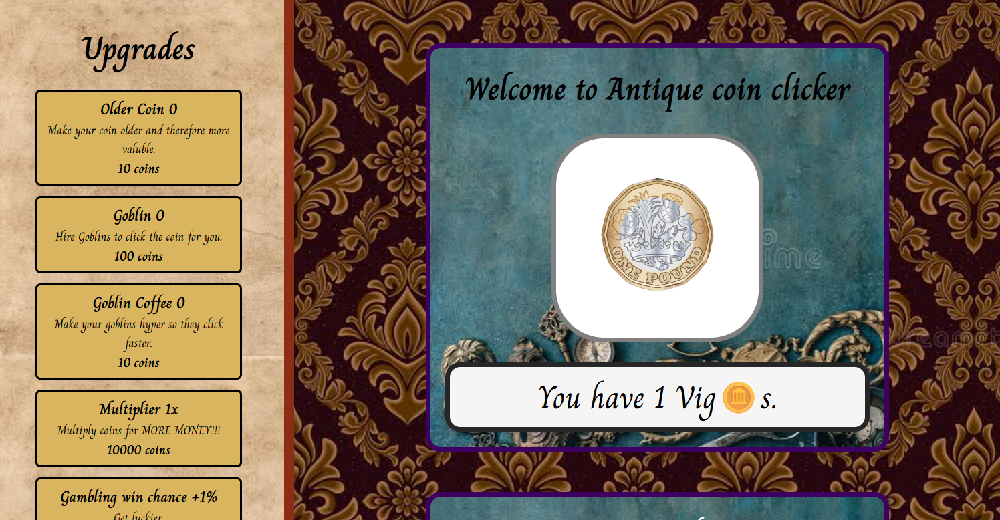
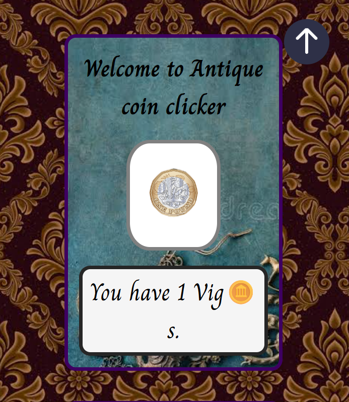
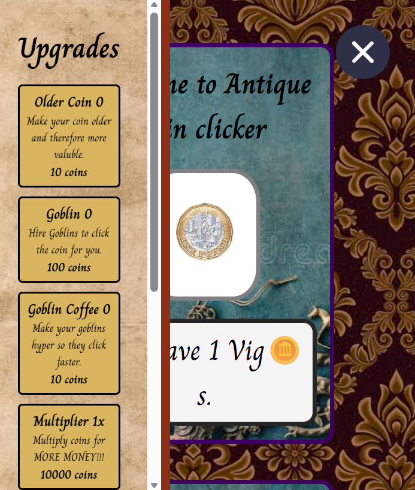

<h1>Antique Coin Clicker </h1>

Play here - https://proffd-17.github.io/Antique-Coin-Clicker/

A game inspired by cookie clicker, collect coins, hire goblins and gamble.

How to play:
1. click on the coin to get coins
2. buy upgrades from the upgrade menu to click for you and increase your profits
3. gamble it all away
The game ends when you get over 100 Trig(~10^34) or one of the upgrade costs becomes over 100 Trig(~10^34)

I made this game because I wanted to get better at JS since I just learned it and I also like the game cookie clicker.
The theme is antique coins because it was antique week but I dont know any thing about antique coins so dont take the fun facts to litteraly because they might be wrong.
I got the images online and the websites I got them from are at the bottom of the page.

Features:
- clicking the coin gets you more coins
- you can upgrade the age of the coin so clicking it gives more coins
- every time you upgrade the coin you get a fun fact about antique coins
- you can buy goblins to click for you
- the coin age does not affect the goblins but the goblin upgrade does
- feed the goblins coffee to make them click faster
- you can buy the upgrade to multiply how many coins you get
- you can gamble coins for a chance to double them or lose it all
- you can buy an upgrade to increase your win chance when gambling(max is 51%)
- modals for not enough money and if you won/lost at gambling as well as fun facts

Here is the main interface on large screens:

And on mobile the upgrades bar colapses:

Built with:
- HTML
- CSS
- JS

What I learned:
- how to make a modal
- how to make a sidebar
- transfering skills from python in to js syntax
- dont gamble

Credits:
Images:
- imgbin
- picryl
- pngtree
- wikipeida commons
- vecteezy
- dreamstime
Ideas:
- cookie clicker
- Chis -for the fun fact idea

